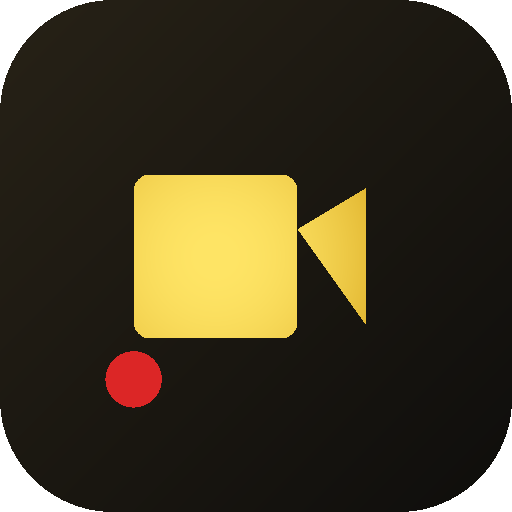

<div align="center">
  

  <h1>Rekoto</h1>

  <p><strong>A local, private screen recorder for Windows — screen, window, or camera, saved as MP4 on your PC.</strong></p>

  <p>
    <a href="LICENSE"></a>
    <a href="docs/"></a>
    
  </p>
</div>

**[See Rekoto →](https://ktsoaela.github.io/rekoto/)**

**Author:** [Khotso Tsoaela](https://github.com/ktsoaela) (`@ktsoaela`)

---

**Rekoto** records your screen, a single window or app, or just your camera, with a round camera bubble of you. Videos stay as MP4 files in a library on your machine.

Nothing is uploaded. There are no accounts and no cloud.

---

## Why Rekoto

- **Full screen, one window, or camera only.** Microphone and system audio are optional, with a mic level meter.
- **Rounded camera bubble.** Draggable, four sizes (hover to change). The on-screen bubble is hidden from capture; Rekoto draws the camera into the video at the same spot.
- **Studio background.** Place the captured window on a branded background (gradient, solid colour, or your image), plus an optional company logo and caption.
- **Clean desktop mode (Windows).** While recording, swap the wallpaper, hide desktop icons, minimize other apps, and optionally hide the taskbar. Everything restores when you stop (and after a crash, on next launch).
- **Browser privacy (Chrome, Edge, Firefox).** Mask passwords, one-time codes and card numbers; crop tabs and the address bar; start, pause and stop from the toolbar.
- **Floating controls.** Timer plus pause, stop and discard — never in the recording. Shortcuts: `Alt+Shift+S` stop, `Alt+Shift+P` pause/resume, `Alt+Shift+C` discard.
- **Library.** Thumbnails, durations, search, in-app player, rename, show in folder, delete (Recycle Bin).
- **Save folder.** Default `Videos\Rekoto`. Change it in Settings or from the Library header.

---

## Quick start

**Requirements:** Node.js 20+, Windows 10 version 2004 or later (for overlay capture protection).

```bash
npm install
npm run icons      # taskbar / desktop icon assets
npm run build:ext  # Chrome / Edge / Firefox companions
npm run dev        # run in development
npm run build      # build app bundles into out/
npm run dist       # Windows installer into dist/ (uses build/icon.ico)
```

If `npm install` did not download Electron, run `node node_modules/electron/install.js`.

| Goal | Command |
| --- | --- |
| Dev app | `npm run dev` |
| Rebuild icons | `npm run icons` |
| Build extensions | `npm run build:ext` |
| Typecheck | `npm run typecheck` |
| Windows installer | `npm run dist` → `dist/` |

### Icons

| File | Use |
| --- | --- |
| `build/icon.ico` | Windows taskbar, installer, and desktop shortcut |
| `build/icon.png` | Electron window icon source (512×512) |
| `assets/rekoto-logo.png` | README / brand mark |
| `assets/Rekoto-Desktop.png` | Standalone 256×256 desktop icon PNG |

---

## Browser extensions

When the app starts, it registers its native-messaging browser connection for Chrome, Edge and Firefox (current user only). Check status in **Settings → Browser privacy**.

- **Chrome or Edge:** `chrome://extensions` (or `edge://extensions`) → Developer mode → Load unpacked → `extensions/chrome`.
- **Firefox:** `about:debugging#/runtime/this-firefox` → Load Temporary Add-on → `extensions/firefox/manifest.json`.

Shared extension source lives in `extensions/shared`. After editing it, run `npm run build:ext`.

---

## How it works

```
Browser extension ──native messaging──> host.js ──named pipe──> Electron main
                                                                     │
   screen/window ─┐                                                  ├─ clean desktop (PowerShell + Win32)
   camera ────────┼─> compositor (background → cropped frame → round camera)
   background ────┘          │
                       MediaRecorder ──chunks──> temp file ──ffmpeg──> MP4 in your save folder ──> library
```

| Area | Path |
| --- | --- |
| Recording session | `src/main/recording.ts` |
| Clean desktop | `src/main/clean-desktop.ts` |
| Browser bridge | `src/main/native-bridge.ts` |
| Library / ffmpeg | `src/main/library.ts`, `src/main/ffmpeg.ts` |
| Studio compositor | `src/renderer/src/studio/` |
| Native host | `native-host/host.js` |
| Extensions | `extensions/` |

### Notes

- Hardware video encoding is off by default (some Windows GPU drivers hang MediaRecorder). To try it: `Rekoto_HW_ENCODE=1`.
- Overlay windows use `setContentProtection` (Windows 10 2004+).
- Password masking covers normal page inputs. Fields in closed shadow DOMs, or in a password-manager window, are not masked — use clean-desktop mode to minimize those windows. Chrome’s own password UI is not maskable.

---

## Documentation map

| Doc | Purpose |
| --- | --- |
| [docs/index.html](docs/index.html) | Public product page (GitHub Pages) |
| [CHANGELOG.md](CHANGELOG.md) | Release history |
| [CONTRIBUTING.md](CONTRIBUTING.md) | Dev setup and PR guidelines |
| [design-system/rekoto/MASTER.md](design-system/rekoto/MASTER.md) | UI colours, layout, brand rules |

Turn on GitHub Pages for the `docs` folder on the `main` branch.

---

## License

MIT © Khotso Tsoaela
